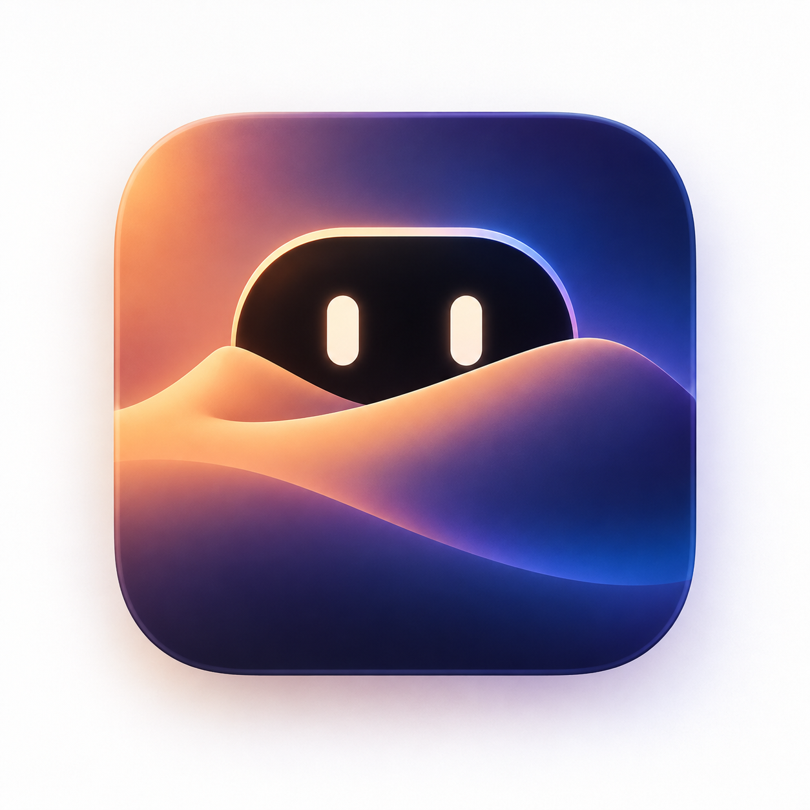

# Sandy



[English](README.md) · [Русский](README.ru.md) · [Қазақша](README.kk.md) · [Deutsch](README.de.md) · [Français](README.fr.md) · [Español](README.es.md) · [简体中文](README.zh-Hans.md) · [日本語](README.ja.md)

**Рабочая панель у верхнего края Mac.**

Sandy — нативная утилита macOS: музыка, файлы, буфер обмена, заметки и наблюдение
за локальными AI-агентами в одном месте. Наведите курсор на вырез MacBook или
нажмите **⌃⌥Пробел**. На мониторе без выреза панель открывается из полоски сверху.

Проект развивает Abdirakhym на основе
[Cyclop](https://github.com/akalikbergenov/cyclop), опубликованного под MIT.
Адаптация Sandy, локализации и интеграция агентов находятся в этом репозитории.
Происхождение кода указано в [THIRD_PARTY_NOTICES.md](THIRD_PARTY_NOTICES.md).

**Состояние проекта:** версия **0.2.0**, установка из исходников. Мобильный доступ
запланирован; текущая сборка отправляет уведомления об агентах только на Mac.

## Возможности

| Раздел | Для чего нужен |
|---|---|
| Музыка | Посмотреть трек и управлять поддерживаемыми плеерами через Now Playing; для Apple Music и Spotify есть запасная интеграция. |
| Полка файлов | Держать ссылки на файлы, перетаскивать их между приложениями, копировать выделение. Предпросмотр через Quick Look, распознавание текста на картинках, отправка .txt в телесуфлёр. Удаление карточки не удаляет оригинал. |
| Буфер обмена | Найти недавно скопированный текст, файл или отметку о картинке; есть поиск. Размер истории настраивается (40–500), опционально хранится между запусками; выбранные приложения можно исключить из записи. |
| Заготовки | Сохранить адрес, шаблон ответа или команду и быстро скопировать их. |
| Календарь | Посмотреть ближайшие встречи из календарей Mac и открыть поддерживаемую ссылку на созвон; по желанию — уведомление за 1–10 минут до начала. |
| Перевод | Перевести текст на устройстве через системные языковые пакеты; пара языков выбирается в настройках или определяется автоматически (английский ↔ русский). |
| Валюты | Пересчитать сумму по публичным курсам; обновление требует интернета. |
| Агенты | Наблюдать сессии Claude Code и Codex, фильтровать их по источнику и состоянию, закреплять важные. Вырез вспыхивает при готовом ответе (отключается); проект открывается в Terminal или редакторе. |
| Заметки | Записать мысль без отдельного окна. |
| Телесуфлёр | Читать прокручиваемый текст рядом с камерой во время записи демо, выступления или звонка. |
| Утилиты | Запустить таймер, удерживать Mac от сна или заблокировать клавиатуру для очистки после предоставления Универсального доступа. |
| Настройки | Выбрать язык, менять порядок и видимость вкладок, способ открытия панели, профили «Работа», «Встречи», «Фокус», размер, цвет и анимации; посмотреть диагностику. |

Мониторинг агентов пассивный: Sandy не запускает запросы к моделям и не
подтверждает действия. Полнота событий зависит от источника. Запросы разрешений
и ошибки Codex не всегда попадают в доступные журналы. История хранит метаданные
сессий и итоги, а не полную запись каждого действия.
[Ограничения интеграции](docs/agent-bridge.md).

## Установка на Mac

Нужны **macOS 15 или новее**, **Swift 6 или новее** и **Python 3** для проверки
локализаций. Достаточно актуальных Xcode Command Line Tools, полный Xcode
необязателен. Наличие выреза у MacBook тоже необязательно.

### 1. Подготовьте инструменты

Откройте **Терминал**: Программы → Утилиты → Терминал. Выполните:

```sh
xcode-select --install
```

Завершите установку в системном окне. Если инструменты уже установлены,
переходите дальше. Проверьте версии:

```sh
swift --version
python3 --version
```

Версия Swift должна начинаться с 6 или более нового числа. Если выбран старый
компилятор, обновите инструменты разработчика или выберите установленный актуальный
Xcode. Для сборки Sandy не нужен ключ API и не требуется подписка на AI-сервис.

### 2. Скачайте проект

На GitHub-странице этого репозитория нажмите **Code → Download ZIP**. Распакуйте
архив и откройте полученную папку в Finder. Если пользуетесь Git, можно клонировать
репозиторий обычным способом.

В Терминале напишите `cd ` с пробелом, перетащите папку проекта из Finder
в Терминал и нажмите Return. В папке должны быть `Package.swift`, `Sources`
и `Scripts`.

### 3. Соберите и откройте Sandy

```sh
./Scripts/bundle.sh
```

Дождитесь успешного завершения. Скрипт собирает приложение и хелперы агентов
и медиа, добавляет восемь локализаций и проверяет подпись. Результат находится
в **`build/Sandy.app`**. Откройте папку:

```sh
open build
```

Перетащите **Sandy.app** в **Программы** и запустите оттуда. Сначала выберите
постоянное место приложения, затем включайте автозапуск и устанавливайте hooks
Claude: они ссылаются на хелпер внутри конкретной копии Sandy.app.
Для запуска прямо из папки разработки:

```sh
open build/Sandy.app
```

Обычного окна и значка в Dock не будет: Sandy работает в строке меню.
Наведите курсор на вырез или полоску сверху, нажмите значок в строке меню либо
**Control + Option + Пробел**.

Локальная сборка использует ad-hoc подпись. Для публичного выпуска с Developer ID
и нотаризацией нужны учётные данные разработчика:
[инструкция по подписи](docs/signing.md). Опубликованный DMG или версия в App Store
в этом README не заявлены. Если macOS блокирует проверенную вами ненотаризованную
сборку, используйте [инструкцию Apple](https://support.apple.com/en-us/102445):
после первой попытки запуска в Системные настройки → Конфиденциальность
и безопасность может появиться **«Всё равно открыть»**. Отключать защиту не требуется.

Подробно, с результатом каждого шага: [настройка Sandy на Mac](docs/installation.ru.md).

## Первая настройка

1. Откройте **Настройки → Общее → Язык**. Доступны английский, русский,
   казахский, немецкий, французский, испанский, упрощённый китайский и японский.
   Панель меняется сразу. Системные запросы разрешений применят язык после
   перезапуска Sandy. **«Язык системы»** следует настройкам macOS.
2. Оставьте **Control + Option + Пробел** или выберите **Control + Shift + Пробел**,
   **Command + Shift + Пробел**, **Control + Option + S**. При конфликте выберите
   другой вариант. Повторное сочетание или Esc закрывает панель; активное поле
   ввода может сначала обработать Esc. Универсальный доступ для вызова не нужен.
3. В **«Показывать в панели»** оставьте нужные разделы. В **«Экраны»** настройте
   показ на нескольких мониторах и вид панели на экране без выреза.
4. При желании включите **«Запускать при входе»**. Если скрыли значок в строке
   меню, повторное открытие Sandy из Программ вернёт его.
5. Проверьте **Снимки экрана → Сохранять снимки из буфера**. По умолчанию функция
   включена: она сохраняет **любую PNG/TIFF-картинку из буфера**, в том числе
   скопированную из браузера, в `~/Pictures/Sandy`. Если это не нужно, выключите.
   Наблюдение за папкой снимков — отдельная настройка с выбором папки.

### Подключение Claude Code и Codex

Агенты должны быть установлены и работать локально. Sandy не устанавливает
их и не предоставляет подписку или ключ модели.

1. Откройте **Настройки → Мониторинг агентов**, включите **«Мониторинг»**
   и нужные источники.
2. Для Claude Code нажмите **«Установить hooks Claude»**. Sandy добавит свои
   hooks в настройки Claude, сохранив существующие и создав резервную копию.
   Изменение происходит только по этой кнопке. Запустите или продолжите локальную сессию.
3. Для Codex хелпер наблюдает поддерживаемые локальные rollout-журналы.
   Облачные задачи текущая интеграция не показывает.
4. Включите **«Уведомления агентов»** и разрешите уведомления в системном окне.
   Поддерживаемые события могут сообщать о готовом ответе, ожидании ввода или
   ошибке; ограничения каждого источника сохраняются.
5. На вкладке **«Агенты»** проверьте сессии и статистику. При потере связи
   используйте **«Повторить»**. Отключённый агент не считается завершившим работу.

После переноса приложения удалите старые hooks и установите их из постоянной
копии Sandy. Совместимость и источники: [мониторинг](docs/agent-monitor.md),
[устройство хелпера](docs/agent-bridge.md).

### Перевод и разрешения

Вкладка **«Перевод»** по умолчанию выбирает **английский ↔ русский** независимо
от языка интерфейса. В **Настройки → Перевод** можно задать исходный и целевой
язык; доступность пары зависит от macOS и установленных пакетов. Если пакетов
нет, нажмите **«Языки перевода…»**, скачайте нужные в системных настройках
«Язык и регион», вернитесь и нажмите **«Повторить»**. Текст переводится на устройстве.

В **«Календаре»** нажмите кнопку предоставления доступа и выберите календари.
Блокировка клавиатуры запрашивает Универсальный доступ отдельно, когда вы её
используете. Запасная интеграция с плеером также может запросить Автоматизацию
или Универсальный доступ. Запись экрана Sandy не требуется.

## Управление с телефона

**В Sandy 0.2.0 ещё не реализовано.** Сейчас нет мобильного приложения,
удалённых push-уведомлений, сопряжения и API подтверждений. Уведомление Mac
само по себе не становится уведомлением iPhone или Android.

Планируемый сценарий:

- **iPhone и Android:** состояние сессий, последние операции, длительность
  и уведомления о завершении, ошибке или запросе ввода, включая разные сети.
- **iPhone:** Live Activities на экране блокировки и Dynamic Island
  на поддерживаемых моделях.
- **Подтверждение:** Allow/Deny конкретного ожидающего действия после проверки
  владельца телефона, с коротким сроком и однократным применением на Mac.
- **Защита:** отзыв доступа устройства, зашифрованная связь и журнал с ограничением
  чувствительных данных. Безусловный автоапрув в этот сценарий не входит.

В [разборе Coucou и плане безопасности](docs/mobile-security-review.ru.md)
описаны механизмы проекта-образца, различия iOS/Android, недостающие части Sandy
и проверки перед выпуском. Mac должен оставаться включённым, не спать и иметь
связь для передачи новых событий. Это план, а не инструкция включения готовой функции.

## Данные и приватность

| Данные | Где находятся |
|---|---|
| Настройки | `~/Library/Application Support/Sandy/config.json`; язык и часть настроек конкретного Mac — в настройках приложения macOS. |
| Заметки, заготовки, телесуфлёр | Файлы в `~/Library/Application Support/Sandy`; читаемые локальные данные, не зашифрованный сейф. |
| История буфера | По умолчанию в памяти. Настройки → Буфер обмена позволяют включить сохранение текста и ссылок на файлы в `clipboard.json`; по умолчанию оно выключено. |
| Картинки из буфера | `~/Pictures/Sandy`; сохраняются отдельно от текстовой истории и остаются до очистки. |
| Полка | Ссылки на исходные файлы; удаление карточки не удаляет оригинал. |
| История агентов | `~/Library/Application Support/Sandy/Agents/history.json`; до 30 дней и 2000 сессий. Без промптов, ответов и сырого вывода команд. |

Режим приватности закрывает содержимое панели, но не шифрует файлы. У Sandy нет
телеметрии, автоматического обновления или телефонного сервера. Конвертер
скачивает публичные курсы, запасная интеграция Spotify может скачивать обложки.
Разрешения, сеть и хранение: [SECURITY.md](SECURITY.md).

## Если что-то не работает

| Симптом | Что проверить |
|---|---|
| Нет окна и значка в Dock | Используйте значок в строке меню, наведение сверху или ⌃⌥Пробел. |
| Не срабатывает сочетание | Включите его в «Общее», при конфликте выберите другой вариант. |
| Нет агентов | Включите вкладку, мониторинг и источник; для Claude явно установите hooks; проверьте статус хелпера. |
| Нет уведомлений на Mac | Разрешите их в Sandy и macOS, проверьте «Фокусирование». Не каждый источник передаёт все состояния. |
| Переводчик просит пакет | Скачайте пакеты выбранной пары и повторите; доступность зависит от macOS, а не от языка интерфейса. |
| Не отображается музыка | Запустите трек в поддерживаемом плеере. Основная интеграция зависит от поведения macOS. |
| Ошибка сборки | Проверьте версии macOS, Swift и Python, текущую папку и сохраните полный текст ошибки. |
| На телефон ничего не приходит | Мобильный доступ ещё не добавлен; см. план выше. |

Для обновления закройте Sandy, соберите новую версию, замените приложение в том
же месте в Программах и откройте снова. Для удаления сначала нажмите **«Удалить
hooks Claude»**, выключите автозапуск, закройте Sandy и удалите приложение.
Папку данных и `~/Pictures/Sandy` удаляйте отдельно, только если хотите стереть
сохранённый текст и изображения.

## Разработка и проверки

```sh
python3 Scripts/check-localizations.py  # Строки интерфейса и разрешений
./Scripts/test.sh                      # Хранилища, интеграции и протокол
./Scripts/bundle.sh                    # Сборка и проверка Sandy.app
./Scripts/test-helper.sh               # Проверка медиахелпера из сборки
./Scripts/dmg.sh                       # Пересборка и образ Sandy-0.2.0.dmg
```

Автотесты не заменяют проверку наведения, drag and drop, воспроизведения,
реальных календарей и доставки на телефон. Результаты и непроверенные сценарии:
[проверка функций](docs/functional-check.md),
[чек-лист перед выпуском](docs/release-checklist.md).

Стек: SwiftUI, AppKit и Swift Package Manager. Основной код — `Sources/Sandy`,
хелпер агентов — `Sources/SandyAgentBridge` и `Sources/AgentBridgeCore`,
медиахелпер — `Sources/SandyMediaHelper`, переводы — `Resources/*.lproj`.
Версия задаётся в `Scripts/version`. Now Playing использует приватный фреймворк
macOS и системный Perl; обновления могут потребовать доработок, а текущая
интеграция не подходит для App Store.

Исходник иконки — `Resources/AppIcon.png`. `Scripts/make-icon.swift` упаковывает
его в стандартные размеры macOS; `bundle.sh` создаёт ICNS для бандла автоматически.

Документация: [архитектура](docs/architecture.ru.md),
[правила разработки](CONTRIBUTING.md), [подпись](docs/signing.md),
[пошаговая установка](docs/installation.ru.md),
[готовые тексты для Threads и LinkedIn](docs/social-posts.md).

## Лицензия и авторство

[MIT](LICENSE). Sandy включает код Cyclop ревизии
`125eb02fbd28b443fe922334ae09823d4ad38df6`, © 2026 akalikbergenov.
При распространении сохраняйте лицензию и
[уведомления о стороннем коде](THIRD_PARTY_NOTICES.md); оба файла входят в бандл.
Coucou изучается как пример будущего мобильного доступа; его имя, персонаж
и звуки в Sandy не перенесены.
