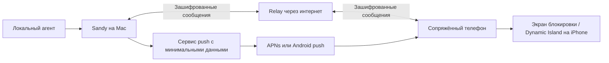

# Мобильный доступ Sandy: разбор Coucou и план безопасности

Дата изучения: **26 октября 2026**. Исходники Coucou зафиксированы на коммите
[`47d1c2da12bf1dce8fb28b825757d497c1e1d88d`](https://github.com/Louis-CFM/coucou/tree/47d1c2da12bf1dce8fb28b825757d497c1e1d88d)
от 23 октября 2026. Проверялись документация и код; чужие установщики, hooks,
серверы и мобильные приложения не запускались. Это разбор архитектуры и
ограничений, не завершённый аудит развёрнутого сервиса или испытание телефона.

**В Sandy мобильного доступа пока нет.** Ниже отдельно описаны факты о Coucou
и предлагаемая разработка Sandy. Целевой сценарий — Mac и телефон в разных
Wi‑Fi либо телефон в мобильной сети; ограничение одной домашней сетью отменено.

## Что есть в Coucou

| Возможность | Реализация в изученной версии | Что это означает для Sandy |
|---|---|---|
| Mac → iPhone | Нативное iOS-приложение, общий Apple Account и private CloudKit database. | Не зависит от одной Wi‑Fi сети, но требует своей iOS-цели и iCloud-конфигурации. |
| Уведомления iPhone | CloudKit subscription для запросов разрешений; обработка изменений сессий и уведомлений на телефоне. | Одного вызова macOS UserNotifications недостаточно. |
| Экран блокировки / Dynamic Island | ActivityKit, расширение виджетов и отдельный APNs relay. | Нужны нативные компоненты iOS и push-инфраструктура. Dynamic Island есть только на подходящих моделях. |
| Allow/Deny | Решение для ожидающего запроса сверяется на Mac и передаётся конкретному hook. | Это явное подтверждение действия, а не безусловный автоапрув. |
| Android по LAN | QR-сопряжение, токен и закреплённый отпечаток TLS-сертификата; инструкция для Windows/Linux. | Нельзя считать это готовой связкой Sandy Mac → Android. |
| Android через интернет | Отдельный WSS relay и шифрование между концами; в документации отмечены готовые стадии R3/R4. | Есть полезный протокол, но фоновая работа на настоящем Android и production relay не подтверждены этим исследованием. |

Платформенные требования и поведение описаны в
[iPhone guide](https://github.com/Louis-CFM/coucou/blob/47d1c2da12bf1dce8fb28b825757d497c1e1d88d/docs/IPHONE.md),
[Android README](https://github.com/Louis-CFM/coucou/blob/47d1c2da12bf1dce8fb28b825757d497c1e1d88d/android/README.md)
и [спецификации интернет-канала](https://github.com/Louis-CFM/coucou/blob/47d1c2da12bf1dce8fb28b825757d497c1e1d88d/docs/RELAY_LINK.md).
Описание Android в основной инструкции относится к LAN; интернет-канал описан
отдельно. Это разные механизмы, не одна одинаково готовая функция для всех платформ.

## Как проходит подтверждение на iPhone

1. На Mac возникает настоящий ожидающий PermissionRequest. Coucou сохраняет
   соединение с соответствующим hook и ставит запрос в очередь.
2. `ApprovalRelay` публикует `ApprovalRequest` в приватной базе CloudKit.
   Инструмент и команда записаны через `encryptedValues`; fingerprint,
   идентификатор агента и время — обычные поля записи.
3. Телефон получает уведомление. Карточка команды использует проверку владельца;
   действия уведомления помечены `authenticationRequired`. Это может быть
   биометрия **или код устройства**, поэтому обещать «только Face ID» некорректно.
4. Телефон записывает `Decision`. Mac опрашивает изменения примерно раз в две
   секунды, пока запрос актуален, и повторно сверяет fingerprint перед ответом hook.
5. Мобильный relay принимает только Allow/Deny. Ожидание на Mac ограничено
   примерно 115 секундами; при истечении он закрывает ожидание без разрешения,
   оставляя агенту собственный запрос в терминале.

Источники:
[ApprovalRelay.swift](https://github.com/Louis-CFM/coucou/blob/47d1c2da12bf1dce8fb28b825757d497c1e1d88d/NotchBuddy/Sources/App/PhoneLink/ApprovalRelay.swift),
[HookServer.swift, очередь и ответ](https://github.com/Louis-CFM/coucou/blob/47d1c2da12bf1dce8fb28b825757d497c1e1d88d/NotchBuddy/Sources/App/HookServer.swift#L900),
[Decisions.swift](https://github.com/Louis-CFM/coucou/blob/47d1c2da12bf1dce8fb28b825757d497c1e1d88d/NotchBuddy/Sources/Phone/Decisions.swift),
[действия уведомления](https://github.com/Louis-CFM/coucou/blob/47d1c2da12bf1dce8fb28b825757d497c1e1d88d/NotchBuddy/Sources/Phone/AgentNotifier.swift#L59),
[отправка решения телефоном](https://github.com/Louis-CFM/coucou/blob/47d1c2da12bf1dce8fb28b825757d497c1e1d88d/NotchBuddy/Sources/Phone/PhoneLink.swift#L513).

Проверка владельца находится в UI/системных действиях, а не внутри самой функции
`decide`. В Sandy её следует сделать обязательной границей отправки Allow для
каждого пути входа, включая deep link, уведомление и Live Activity.

## Хранение и границы доверия

У iPhone содержимое сессий идёт через private CloudKit. Команды, пути, вопросы
и часть текста сессии используют `CKRecord.encryptedValues`; некоторые состояния,
времена и идентификаторы остаются обычными полями. Это не означает, что вся
метаинформация скрыта. Apple описывает ключи таких полей как материал из iCloud
Keychain; сброс ключей требует специальной обработки ошибок и восстановления.
Источники: [SessionPublisher.swift](https://github.com/Louis-CFM/coucou/blob/47d1c2da12bf1dce8fb28b825757d497c1e1d88d/NotchBuddy/Sources/App/PhoneLink/SessionPublisher.swift#L239),
[Apple: Encrypting User Data](https://developer.apple.com/documentation/cloudkit/encrypting-user-data).

Отдельный relay Live Activity видит push-токен и ограниченный набор полей
состояния, включая fingerprint ожидающего действия; он не получает полную команду.
APNs-ключ находится на сервере. Это другой сервер, чем зашифрованный Android relay.
[Код APNs relay](https://github.com/Louis-CFM/coucou/blob/47d1c2da12bf1dce8fb28b825757d497c1e1d88d/relay/src/index.ts).

В Android сопряжение хранится в зашифрованном AES-GCM контейнере с ключом из
Android Keystore; Allow требует сильной биометрии или учётных данных блокировки.
Источники: [SecureStore.kt](https://github.com/Louis-CFM/coucou/blob/47d1c2da12bf1dce8fb28b825757d497c1e1d88d/android/app/src/main/kotlin/com/coucou/android/app/SecureStore.kt),
[BiometricGate.kt](https://github.com/Louis-CFM/coucou/blob/47d1c2da12bf1dce8fb28b825757d497c1e1d88d/android/app/src/main/kotlin/com/coucou/android/app/BiometricGate.kt).
Проверка владельца сама по себе не защищает уже скомпрометированное приложение
на разблокированном телефоне: доверенными остаются оба конечных устройства.

В Android интернет-канале используются ключ сопряжения, HKDF/HMAC, AES-256-GCM,
раздельные ключи направлений и последовательные счётчики кадров. Relay пересылает
шифротекст, но видит адреса, присутствие устройств и характеристики трафика.
При этом **forward secrecy нет**: компрометация постоянного ключа угрожает ранее
записанному трафику. Это прямо указано авторами.
[RelayCrypto.kt](https://github.com/Louis-CFM/coucou/blob/47d1c2da12bf1dce8fb28b825757d497c1e1d88d/android/app/src/main/kotlin/com/coucou/android/link/RelayCrypto.kt),
[relay_crypto.rs](https://github.com/Louis-CFM/coucou/blob/47d1c2da12bf1dce8fb28b825757d497c1e1d88d/windows/src-tauri/src/phone_link/relay_crypto.rs),
[признанные ограничения](https://github.com/Louis-CFM/coucou/blob/47d1c2da12bf1dce8fb28b825757d497c1e1d88d/android/RELAY_THREAT_CHECK.md).

## Что следует доработать перед переносом

Это выводы статического чтения. Эксплуатация чужого сервиса не проводилась.

| Наблюдение в коде | Практический вывод для Sandy |
|---|---|
| Обработчик `relay/src/index.ts` проверяет формат запроса и APNs-токен, но не аутентифицирует вызывающий клиент. | Собственный push relay должен проверять допуск сопряжённого Mac, владение токеном и квоты. Не копировать публичный обработчик как готовый защищённый backend. |
| Ограничение тела APNs-запроса сверяет `Content-Length` до `request.json()`. | Ограничивать фактически принятые байты независимо от заголовка; сохранять пределы полей и частоты запросов. |
| iPhone fingerprint строится из агента, сессии, инструмента, команды и входа, без UUID экземпляра запроса; фильтр решений допускает время `since - 5s`. | Одинаковые повторные действия имеют одинаковый хеш. Для Sandy нужен случайный ID каждого запроса, срок по часам Mac и атомарное погашение. Возможность применения старого решения к повтору требует отдельного теста; здесь она не объявляется доказанной уязвимостью Coucou. |
| `PhoneLink.decide` сохраняет историю до 50 решений с кратким текстом команды в UserDefaults. | Минимизировать содержимое истории телефона, срок хранения, резервные копии и превью; не обещать отсутствие локального следа команд. |
| QR интернет-сопряжения содержит секреты; сервер видит метаданные. | QR не публиковать в демо, сделать его одноразовым и быстро истекающим, требовать подтверждение на Mac и дать отзыв отдельного устройства. |
| Интернет-канал Android не даёт forward secrecy, а фоновые испытания на устройстве отмечены как незавершённые. | Выбрать поддерживаемый проверенный протокол с обновлением ключей; отдельно проверить Doze, батарею и настоящую доставку. |

Первое наблюдение не доказывает обход разрешений агента: ответ агенту идёт
по другому каналу с проверками. Риск обработчика — злоупотребление отправкой
push/ресурсами и подделка отображаемого состояния при утечке нужного токена.
Подтверждённый внешний ingress-контроль развёрнутого сервиса не исследовался.

## Чего не хватает в Sandy

| Часть | Сейчас | Что добавить |
|---|---|---|
| Состояние агента | Есть локальные события и статистика. | Экспорт безопасного снимка, номер последовательности, время последнего контакта. |
| «Все действия» | Есть последняя операция и агрегаты сессии. | Отдельная ограниченная лента событий, отметки пропусков и явное согласие на более подробные данные. |
| Содержимое действия | Хелпер удаляет аргументы, промпты и вывод. | Для подтверждений нужен отдельный канал полного контекста конкретного запроса; одного слова «Запуск команды» недостаточно. |
| Подтверждения | Наблюдение за ожиданием, без управления запросом. | Адаптер официального протокола разрешений агента, ожидающий запрос и ответ именно ему. |
| Телефон | Нет клиентов и сопряжения. | iOS/Android-клиенты, управление устройствами, отзыв, хранилище ключей. |
| Доставка | Локальные уведомления macOS. | APNs/Android push и проверенный канал получения состояния через интернет. |
| Live Activity | Нет iOS-цели. | ActivityKit, WidgetKit, push-токены и обновления с ограничением данных. |

Основание: [текущий монитор](agent-monitor.md),
[контракт хелпера](agent-bridge.md), [безопасность Sandy](../SECURITY.md).
Пассивные Claude hooks Sandy нельзя превратить в управление простой кнопкой
на телефоне: сейчас они намеренно не удерживают запрос агента и не выдают Allow.
Codex-журналы не дают надёжного события каждого approval; поддержку нужно
проектировать через документированный интерфейс соответствующего источника,
а не через нажатие Enter в чужом окне или изменение журналов.

## Предлагаемая схема Sandy для разных сетей

Для обеих платформ целесообразен общий защищённый канал. CloudKit можно оставить
вариантом iPhone, но сам по себе он не решает Android. Следующая схема — проектное
предложение, в репозитории такой сервис не реализован и не развёрнут.

Mac и телефон устанавливают исходящие защищённые соединения; проброс порта
роутера и открытый административный HTTP-сервер Mac не нужны. Push сообщает
о событии; подробности телефон получает по аутентифицированному каналу.
По умолчанию на экране блокировки только «Агенту нужен ответ», без команды,
пути, промпта и содержимого файлов. Сам push не даёт полномочий подтвердить действие.

Начальные права телефона — просмотр. Разрешение на решения включается отдельно
на Mac для конкретного устройства и поддерживаемого источника. Ключи хранятся
в Keychain/Keystore; секреты сопряжения и APNs не входят в репозиторий или
общий бинарник. Отзыв телефона прекращает доступ и отменяет его незавершённые
решения. Недоступность relay не разрешает команду автоматически.

Протокол шифрования нужно выбрать из поддерживаемых проверенных реализаций;
собственная комбинация алгоритмов на основе этого обзора не считается аудитом.
Сервис всё равно видит сетевые метаданные и может задерживать сообщения.
Для push отдельно потребуются квоты, очистка недействительных токенов,
удаление данных и контролируемый доступ к ключу отправителя.

## Контракт подтверждения

На Mac создаётся `request_id` со случайным значением и неизменяемым контекстом:
источник, сессия, инструмент, исходные аргументы, рабочий каталог, время выдачи
и короткий срок. Контекст хранится на Mac; его хеш связывает решение с тем,
что пользователь просмотрел. Запрос получает последовательный номер поколения
сессии, чтобы перезапуск не оживлял прежние решения.

Телефон показывает полное действие в развёрнутой карточке, запрашивает
биометрию/код и отправляет аутентифицированное решение по защищённому каналу.
Команды и аргументы показываются как данные, без исполнения HTML, ссылок или
escape-последовательностей. Если телефон не смог получить полный контекст,
Allow недоступен: пользователь возвращается к Mac.

Перед ответом агенту Mac атомарно проверяет устройство и его права, `request_id`,
поколение, хеш и срок по собственным часам. Только состояние `pending` может
перейти в `allowed` или `denied`. Дубликат, отзыв, отмена на Mac, истёкший запрос
или решение для другого контекста не применяется. Телефон показывает
«Отправляется», затем подтверждённый Mac итог; нажатие кнопки не выдаётся за
факт выполнения команды. Для особо чувствительных операций можно требовать
подтверждение у Mac; правила описываются до включения управления.

## Долгие задачи и ограничения платформ

В карточке задачи нужны состояние, наблюдаемое время, последняя операция,
время свежести и число ожидающих запросов. Пока источник не сообщает общий
объём работы, не рисовать выдуманный процент выполнения. Обновления группировать,
уведомлять при смене важного состояния, а не на каждое чтение файла.
При сне Mac и потере сети показывать устаревшее состояние; не «Готово».

Live Activity — краткая поверхность состояния, не бесконечный журнал. По
[документации Apple](https://developer.apple.com/documentation/activitykit/displaying-live-data-with-live-activities)
она не обращается в сеть самостоятельно, получает обновления из приложения или
через ActivityKit push, имеет ограничение данных 4 КБ и активной жизни до 8 часов.
Для долгих задач нужны корректное завершение/возобновление представления и
обычные уведомления. Отключённые Live Activities не должны ломать просмотр.

Android нельзя считать постоянно подключённым только из-за WebSocket.
[Документация FCM](https://firebase.google.com/docs/cloud-messaging/android-message-priority)
описывает влияние Doze и приоритетов на доставку. Нужны реальные испытания
фонового режима и выбранная стратегия push; обещать мгновенную доставку при
любых настройках батареи нельзя. Отказ от разрешения уведомлений должен
сохранять возможность просмотра в открытом приложении.

## Порядок реализации и критерии готовности

1. **Просмотр:** ограниченная лента событий и снимки сессий; локальные тесты
   порядка, дедупликации, пропусков, срока хранения и маскирования данных.
2. **Сопряжение и интернет:** клиенты iOS/Android, ключи устройств, подтверждение
   пары на Mac, общий канал и отзыв. Проверить разные Wi‑Fi, мобильный интернет,
   смену сети, повреждённые сообщения, неверный ключ и недоступный relay.
3. **Уведомления:** completion/error/input, переход по уведомлению к сессии,
   отсутствие дублей, выключенные разрешения и Focus/Doze. Сравнить журнал Mac
   и доставку на настоящих iPhone и Android с выключенным экраном.
4. **Подтверждения:** только для источника с рабочим протоколом разрешений.
   Проверить двойное нажатие, истечение, одинаковую команду дважды подряд,
   старое решение после перезапуска, другой проект, другую сессию, отмену на Mac,
   отзыв телефона и конфликт двух устройств. Ни один случай не должен разрешать
   посторонний или уже погашенный запрос.
5. **iPhone Live Activities:** начать/обновить/завершить, stale state, модель
   без Dynamic Island, выключенные Live Activities, обновление push-токена,
   работа дольше 8 часов и восстановление после сна Mac.
6. **Выпуск:** проверить содержимое push и серверных журналов, ротацию ключей,
   лимиты и удаление данных; выполнить отдельную проверку безопасности и затем
   записать воспроизводимое демо. До этого функцию нельзя объявлять проверенной.

Для native iPhone-сборки потребуются собственные signing capabilities,
контейнеры и push-настройки Apple; чужой контейнер Coucou нельзя просто оставить
в Sandy. Полный Xcode и физические устройства нужны для мобильной проверки.
Параметры Apple Developer и способ распространения выбираются перед выпуском.

## Что можно обещать в анонсе сейчас

«Sandy показывает поддерживаемые локальные сессии агентов и уведомляет на Mac.
Изучается мобильный доступ для iPhone и Android: наблюдение за долгими задачами,
уведомления и явное подтверждение конкретных действий. На iPhone планируются
экран блокировки и Dynamic Island. Функция ещё не включена в текущую сборку».

Coucou используется как инженерный пример. Его код и ресурсы имеют разные
условия использования; персонаж, имя и звуки не перенесены. Любое будущее
заимствование кода требует сохранения соответствующей лицензии и авторства.
